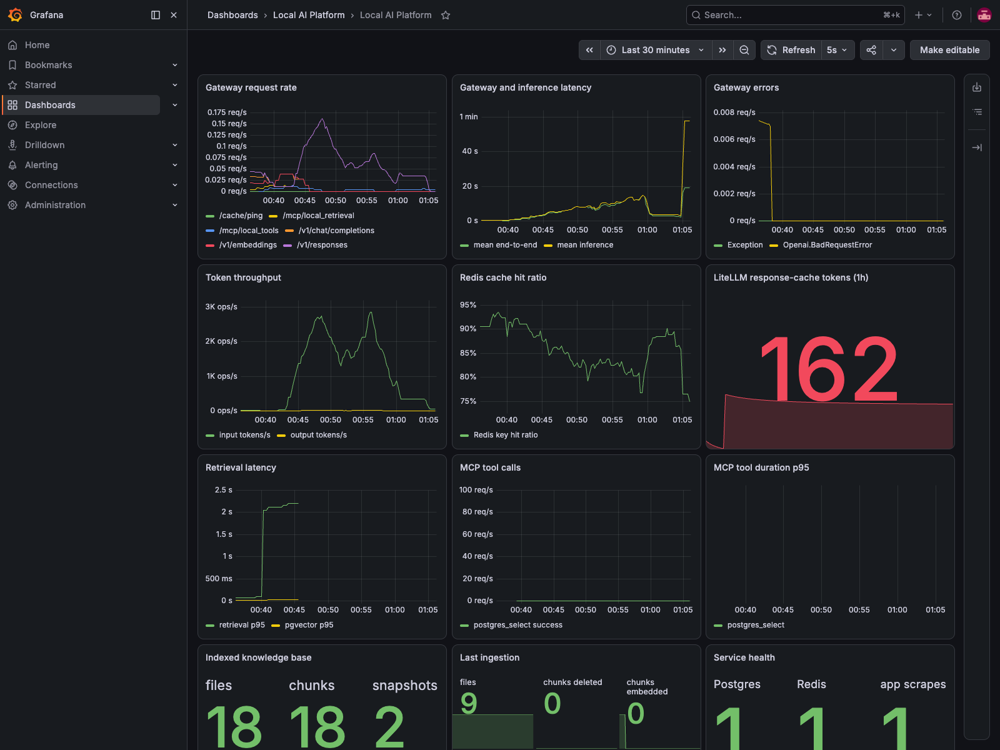

# Local AI Platform

Moyai runs coding tasks locally on Apple Silicon using Qwen through LiteLLM and
Docker Model Runner. PostgreSQL/pgvector provides repository context, Redis
caches gateway responses, and Grafana displays platform metrics.

The [Rust demo acceptance report](docs/results/repository-reliability-2026-11-17.md)
records the task, independent checks and downloaded patch. Run `make verify`
to produce a fresh report on this Mac. Codex CLI and Hermes are optional clients.

Current dependency pins and upgrade verification: [2026-11-16 update](docs/dependency-update-2026-11-16.md).

## Why this exists

A coding agent is more than a local chat UI. It needs a model gateway, tool permissions, retrieval, caching, auditability, and a safe execution boundary. This repository puts those pieces behind one OpenAI-compatible endpoint:

```text
Moyai / optional CLI clients  -> LiteLLM -> local Qwen on Apple Silicon
                                      |
                                      +-> Redis response cache
                                      +-> MCP Gateway
                                      +-> PostgreSQL + pgvector retrieval
                                      +-> Prometheus / Loki / Grafana
```

## Quick start target

Requirements: an Apple Silicon Mac and Docker Desktop 4.40 or newer with at least 32 GiB unified memory. The default 30B coding model is approximately 16.5 GB before runtime and KV-cache overhead; 48 GiB is recommended for a useful coding context.

Cargo must also be available on `PATH`: install the Rust toolchain using the
official [Rust installer](https://rust-lang.org/tools/install/) or
[`brew install rust`](https://formulae.brew.sh/formula/rust), then check
`cargo --version`. `make doctor` checks both command availability and whether
Cargo can run. Verified 2026-11-17 with Homebrew Cargo and Rust 1.100.0.

```sh
git clone https://github.com/taras-kolodchyn/local-ai-platform.git
cd local-ai-platform
make up
```

`make up` diagnoses the host, creates a local `.env`, renders the effective model
configuration, enables Docker Model Runner, pulls pinned model artifacts, and
starts the core services and local Moyai as the single default agent. It retires
the old workspace A2A registrations, verifies health, gateway, cache and scoped
knowledge access, and writes optional Codex/Hermes client examples under `.local/`.
Those client examples do not register or start additional agents in LiteLLM.

`make up` registers all 25 workflows from Addy Osmani's catalog in the **Skills**
section of the [local LiteLLM dashboard](http://127.0.0.1:4000/ui). Registration
uses the checked-in manifest and works offline. Each catalog entry points to its
skill directory at the [pinned MIT-licensed upstream revision](https://github.com/addyosmani/agent-skills/tree/39b723ceebf81474d0557c1fecd01eddab585563/skills).
Installing an upstream entry from the marketplace requires access to GitHub.
The Addy Osmani version of test-driven development appears as
`addyosmani-test-driven-development` alongside the existing Superpowers entry.
Moyai packages [local adaptations of all 25 workflows](integrations/moyai/skills).
To update the instructions Moyai uses, edit the skill's local `SKILL.md` and
run `make up` to rebuild the image. The LiteLLM dashboard manages marketplace entries.
Describe the task in a new chat and Qwen selects the relevant instructions
from the image. The native skill ID for the Addy Osmani TDD workflow is
`test-driven-development`. The browser workflow can analyze a supplied local
DevTools trace, and the release workflow can prepare a rollout from local
evidence. A skill adds instructions within the tools available to the chat.
Registered repository tasks retain their phase-specific tool restrictions.
An ordinary web chat uses one local model request to select relevant engineering
workflows from their descriptions. Qwen loads each selected skill with a separate
native call before answering the original request. It can select an empty list.

Choose **local-qwen-analysis** in Moyai's model picker for chat-only analysis.
It uses the same local Qwen through LiteLLM. The profile permits reading and
listing existing files and loading the selected packaged skills. The workspace
refuses commands and file changes. Plans, proposed code and ADRs go in the
chat. For a shortcut, start a web message with `/analysis` or end it with
“без змін у файлах”. Moyai records the analysis profile on the turn and as the
chat's selected model. Choose **local-qwen** to resume editing on a later turn.
The local integration uses Pydantic AI 2.55.0's
[read-only workspace](https://pydantic.dev/docs/ai/core-concepts/workspace/#read-only-access).

With the platform running, `python3 scripts/moyai-skills-smoke.py` checks a
Rust task that needs planning, code simplification and an ADR. Run
`python3 scripts/moyai-skills-smoke.py --case latency` to check a measurement
and alerting task, or use `--case arithmetic` to check that a simple calculation
loads zero workflows. Each command sends one natural-language message to a new
private chat and prints its URL. It verifies Qwen's selection, the instructions
returned by the native loader, the inline answer and the untouched sandbox.
Marketplace registration and native chat loading were checked on 2026-11-18
with LiteLLM 1.109.1 and Pydantic AI 2.55.0. See the
[LiteLLM marketplace API](https://docs.litellm.ai/docs/tutorials/claude_code_plugin_marketplace)
and [Pydantic AI tool choice](https://ai.pydantic.dev/tools-advanced/#tool-choice).

`make down` stops Moyai, then all platform containers (including previously
enabled profiles), then unloads the configured coding and embedding models from
Model Runner memory. Volumes, conversations and downloaded model artifacts stay
on disk. `make restart` performs this same stop/start cycle. `make status` shows
both service groups and distinguishes resident models from downloaded artifacts.

The former development/review/research workspace runtimes are retired from the
default Compose stack. Moyai keeps its existing files and conversations. The
separate, one-time migration in `scripts/reconcile-agents.py --purge-data` removes only the
retired profiles' volumes, memory database, local state and dedicated keys; it
requires the gateway and database to be running. See [platform operations](docs/platform-operations.md).

Moyai keeps its isolated Compose definition and existing data volumes, while the
public commands manage it as part of the complete stack. The shutdown order
removes its bridge before the core gateway network, then unloads inference after
all platform clients have stopped. A failed cleanup phase makes `make down` fail
after attempting the remaining phases, so it cannot silently report success.
Managed commands pin the canonical Compose project names and files, ignore
ambient Compose overrides, and load model settings from `.env` for both startup
and shutdown. Connected profiles require their explicit opt-in command.

Model unloading uses the official [`docker model unload`](https://docs.docker.com/reference/cli/docker/model/unload/)
command for `QWEN_MODEL` and `EMBEDDING_MODEL` from `.env`; unrelated models and
Docker projects are outside this shutdown. Without `.env`, shutdown uses the
repository defaults and reports that fallback. Docker Desktop remains running;
macOS may retain reclaimable file cache after inference allocations are released.
Verified 2026-11-16 with Docker CLI 29.9.3 and Docker Model Runner 1.2.9.

To use the optional Codex terminal client with the local gateway:

```sh
source .local/client.env
CODEX_HOME="$PWD/.local/codex" codex
```

The generated Codex configuration uses LiteLLM's Responses API bridge and reaches only the allowlisted, read-only MCP tools through the LiteLLM MCP Gateway. The repository `AGENTS.md` keeps retrieved text in the untrusted-data boundary.

Useful commands:

```sh
make help
make doctor
make status
make logs
make smoke-test
make verify
make index REPO=/absolute/path/to/repository
make hermes-smoke
make connected-up
make down
```

## Tests

`make test` requires Python 3.11–3.14 and Cargo. It runs unit and contract tests,
real PostgreSQL memory isolation, and the Rust demo tests using
`cargo test --locked`. Missing or unusable Cargo fails before Python environment
setup, package installation, or database startup; Rust tests are required and
their failures fail the command.

The DB test starts a disposable `pgvector/pgvector:0.8.7-pg17-bookworm` container,
binds a random port on `127.0.0.1`, and runs the production memory provisioner.
Its data lives in tmpfs; the container is removed after success or failure.
This requires a running Docker engine, but no `.env`, models, or running platform
stack. Database startup or provisioning failures fail the test instead of
skipping it. GitHub CI runs the same fixture automatically.

`make verify` runs lint, the full required test suite, startup, JSON status,
endpoint smoke checks and real Moyai file/shell/pytest/artifact acceptance with a
restart. It always attempts `make down` and checks the final owned-container and
resident-model inventories, including after failures or interruption. Private
phase logs and a result receipt are written under `.local/verification/`.

For an explicitly provisioned disposable database, `MEMORY_TEST_DSN` can still
be supplied to use that database instead. The default generates temporary
credentials and exports the DSN only inside pytest.

## Endpoints

All host-facing services bind to loopback by default.

| Service | URL |
| --- | --- |
| LiteLLM API | `http://127.0.0.1:4000/v1` |
| LiteLLM UI | `http://127.0.0.1:4000/ui` |
| Retrieval API | `http://127.0.0.1:8000` |
| Offline MCP tools | `http://127.0.0.1:8001/mcp/` |
| Grafana | `http://127.0.0.1:3000` |
| Prometheus | `http://127.0.0.1:9090` |
| Moyai agent | `http://127.0.0.1:8787` |

Client-facing aliases are `local-qwen` and `local-embeddings`. The Docker Model Runner artifact names are internal implementation details.

The checked-in [`litellm/config.yaml`](litellm/config.yaml) is a template.
`make bootstrap` renders `.local/litellm/config.yaml` from the same `.env` model
references and context used to pull and unload models. Each entry includes an
English `model_info.description` identifying the actual model and its purpose.
Known artifact metadata is attached only to its matching model reference;
overriding the reference cannot retain the old model's label. All LiteLLM
comments and descriptions remain English.
These descriptions are deployment metadata exposed by LiteLLM's `/model/info`
management API, as documented in [model management](https://docs.litellm.ai/docs/proxy/ui_store_model_db_setting).
Metadata preservation was verified on 2026-11-17 with LiteLLM 1.109.1.

`make status` and `make status FORMAT=json` report resolved aliases, model
references, artifact digests/size, resident models and measured host/process
memory when available, without starting services. Artifact context metadata is
separate from the requested context; it does not prove the live engine's context.
Process RSS and artifact size are not reported as Metal memory allocations.

Retrieval now combines pgvector cosine search with PostgreSQL full-text search
over source, symbol names and paths, using reciprocal rank fusion. HTTP, MCP and
scoped vector-store searches share the same scope filters and context bounds.
Raw cosine similarity remains available separately. Vector-store `score` and
`score_threshold` use normalized hybrid relevance rather than cosine similarity;
they are ranking signals, not calibrated probabilities. See [platform operations](docs/platform-operations.md).

## Shared dashboard login (optional)

To use `admin` and one chosen password for both local dashboards, first run
`make bootstrap` from the repository root. Edit these entries in the generated,
Git-ignored `.env`, replacing both placeholders with the same password:

```dotenv
UI_USERNAME=admin
UI_PASSWORD='YOUR_SHARED_LOCAL_PASSWORD'
GRAFANA_ADMIN_PASSWORD='YOUR_SHARED_LOCAL_PASSWORD'
```

Keep the single quotes around the password so characters such as `$` remain
literal. Keep `.env` private; only these dashboard entries need changing.
This is an opt-in setup: bootstrap normally generates separate credentials.

Apply the settings using the supported entry point:

```sh
make up
```

For an existing Grafana data volume, also update its stored admin password;
changing the environment variable alone does not replace it. This command reads
the configured password inside the container and passes it through stdin,
without putting the value in shell history or command arguments:

```sh
docker compose exec -T grafana sh -c '
  printf "%s\n" "$GF_SECURITY_ADMIN_PASSWORD" |
    grafana cli --homepath /usr/share/grafana --config /etc/grafana/grafana.ini \
      admin reset-admin-password --password-from-stdin --user-id 1
'
```

User ID `1` is the default Grafana admin created by this stack. Sign in with
`admin` and your chosen password at [LiteLLM](http://127.0.0.1:4000/ui) and
[Grafana](http://127.0.0.1:3000). Sign out of an existing browser session first
to verify the new login.

`make smoke-test` (also run by `make up`) checks fresh logins using `.env`:
LiteLLM uses `UI_USERNAME` (default `admin`) and `UI_PASSWORD` (falling back to
`LITELLM_MASTER_KEY` when empty); Grafana uses `admin` and
`GRAFANA_ADMIN_PASSWORD`. The check requires a new LiteLLM UI session and
verifies the Grafana session's admin identity. A stale Grafana volume password
therefore fails the smoke test. Passwords and session tokens are kept out of
test output and artifacts.

Verified on 2026-11-16 with LiteLLM 1.109.1 and Grafana 13.3.1. Upstream references:
[LiteLLM UI credentials](https://docs.litellm.ai/docs/proxy/ui) and
[Grafana password configuration](https://grafana.com/docs/grafana/latest/setup-grafana/configure-grafana/#admin_password)
and [admin CLI](https://grafana.com/docs/grafana/latest/administration/cli/).

## macOS inference boundary

Docker Model Runner uses llama.cpp with automatic Metal acceleration on Apple Silicon. On macOS, its inference engine does not run in a normal Linux container; Docker Desktop runs it in a host sandbox and exposes an API to containers. See [ADR 0001](docs/adr/0001-inference-runtime.md) for the decision and fallback design.

## Documentation

- [Architecture](docs/architecture.md)
- [Verified capability matrix](docs/capability-matrix.md)
- [Implementation plan](docs/implementation-plan.md)
- [Inference runtime ADR](docs/adr/0001-inference-runtime.md)
- [Threat model and security design](docs/security.md)
- [Risk register](docs/risks.md)
- [Offline operation](docs/offline.md)
- [Local Moyai coding MVP](docs/moyai-local.md)
- [Opt-in connected mode](docs/connected.md)
- [GitHub issue to a verified Moyai draft PR](docs/moyai-github-issues.md)
- [Troubleshooting](docs/troubleshooting.md)
- [Benchmark method](docs/benchmarking.md)
- [Measured results and agent validation](docs/results/agent-validation-2026-07-19.md)
- [Ukrainian DOU article draft](docs/dou-article.md)



## Security posture

The default profile is offline and localhost-only. MCP tools are allowlisted, external credentials are absent, request bodies are not shipped to a remote telemetry service, and the Docker socket is not mounted. Local does not mean automatically safe: code, documentation, models, containers, MCP servers, and generated shell commands remain part of the attack surface.

See [SECURITY.md](SECURITY.md) for reporting vulnerabilities.

## License

Apache-2.0. See [LICENSE](LICENSE).

See [current platform operations](docs/platform-operations.md) for models,
verification, hybrid search and the single-agent stack. The previous
[workspace profile design](docs/workspace-memory.md) is retained as historical documentation.
