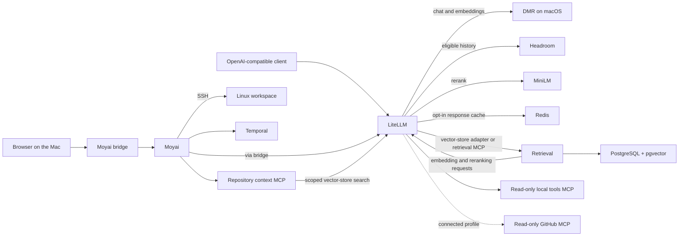

# Architecture

The platform runs on one Apple Silicon Mac. LiteLLM is the client-facing gateway.
Docker Model Runner (DMR) serves generation and embeddings with llama.cpp on the
macOS host, where it can use Metal. MiniLM reranks source excerpts on a container
CPU. See the [runtime decision](adr/0001-inference-runtime.md) and the
[component versions](capability-matrix.md).

## Inference requests

Clients send a scoped virtual key to `http://127.0.0.1:4000/v1`. The gateway maps
`local-qwen` and `local-embeddings` to the configured DMR artifacts at
`host.docker.internal:12434/engines/v1`. The `local-reranker` alias routes to
`reranker:8080`. Moyai's inference key only grants access to `local-qwen`.
Its analysis profile selects the same gateway model with read-only workspace
tools. [Model template](../litellm/config.yaml) · [Moyai profiles](moyai-local.md)

For Responses clients, `local-qwen` enables the Chat Completions bridge. The
live smoke test requests a function call, then submits its output using the
returned `call_id` and `previous_response_id`. It also checks streaming on a
separate request. [LiteLLM Responses API](https://docs.litellm.ai/docs/response_api) ·
[Endpoint checks](../scripts/smoke-test.sh)

Headroom runs as a default pre-call guardrail for eligible history. LiteLLM
continues with the original request if the compressor is unreachable. A
caller can send `x-headroom-bypass: true` to compare token usage on the same
input. [LiteLLM Headroom integration](https://docs.litellm.ai/docs/proxy/headroom)

## Source and tool access

- Incremental ingestion mounts the chosen directory read-only, excludes ineligible
  files, chunks the text and embeds it through the gateway. Search combines
  pgvector cosine ranks with PostgreSQL full-text ranks over paths, symbols and
  content. [Search and scoring](platform-operations.md#hybrid-retrieval)
- Registering a supported checkout creates an immutable source snapshot and an
  indexed generation. Moyai's context MCP uses a separate gateway credential,
  binds search to the attached generation and returns bounded, line-referenced
  source. The controller independently verifies repository edits before releasing
  artifacts. [Repository workflow](repository-workflow.md)
- The offline tools server mounts its workspace read-only, exposes allowlisted
  filesystem and Git operations, and connects to PostgreSQL as `mcp_reader`.
  The opt-in GitHub MCP server takes a caller-supplied credential.
  [Connected mode](connected.md)
- Retrieved text and command output are untrusted input to the model. Moyai
  executes commands over SSH in its sandbox's private workspace. The host
  publisher is a separate opt-in command. [Security design](security.md) ·
  [Issue publication](moyai-github-issues.md)

## Deployment and observability

The core Compose project publishes LiteLLM (4000), retrieval (8000), offline
MCP (8001), Grafana (3000) and Prometheus (9090) on IPv4 loopback. PostgreSQL,
Redis, Loki, Alloy, the exporters, Headroom and MiniLM have no published ports.
Prometheus scrapes configured targets and Alloy tails the local service log files
for Loki. The data, observability, compression and ranking networks are internal.
The gateway network reaches DMR on the host. [Core Compose services](../compose.yaml)

The Moyai Compose project publishes its bridge on loopback port 8787. The
sandbox joins only its internal network. The context service joins the core
gateway and observability networks. Named volumes hold conversations, workspace
files and Temporal state. [Moyai Compose services](../compose.moyai.yaml)

## Cache taxonomy

| Mechanism | Owner and behavior |
| --- | --- |
| Exact response cache | LiteLLM stores eligible Chat Completions in Redis when the request opts in with `"cache":{"use-cache":true}`. The default TTL is 300 seconds. |
| Semantic response cache | Disabled. The gateway has no backend configured for reusing answers to similar prompts. |
| Inference KV cache | DMR's inference engine manages attention state in runtime memory. Requested context affects the memory budget. |
| Embedding reuse | Ingestion reuses compatible indexed vectors for unchanged chunks or an existing immutable generation. |
| Knowledge base | PostgreSQL/pgvector persists source text, embeddings, identifiers and citation coordinates for search. |

[LiteLLM caching](https://docs.litellm.ai/docs/proxy/caching) ·
[Ingestion implementation](../retrieval/src/local_ai_retrieval/ingestion.py)
